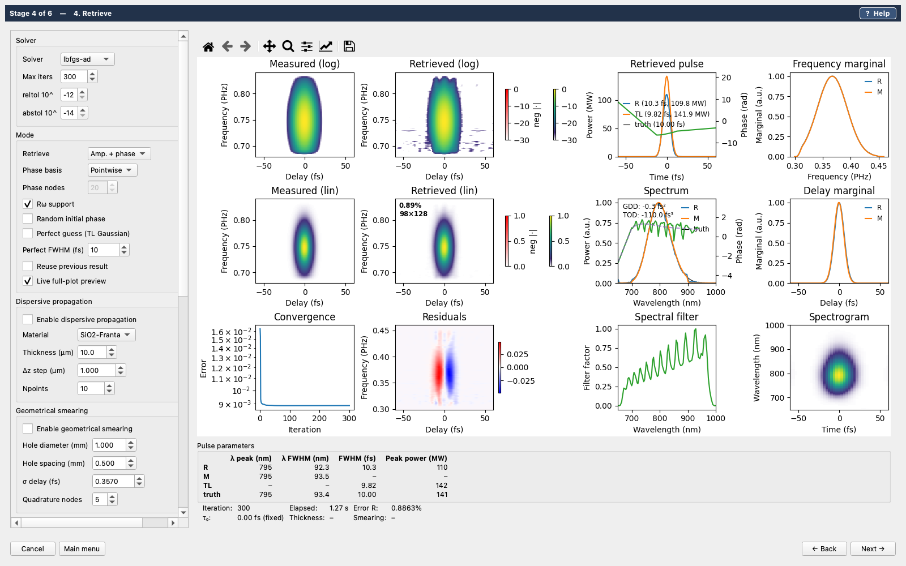
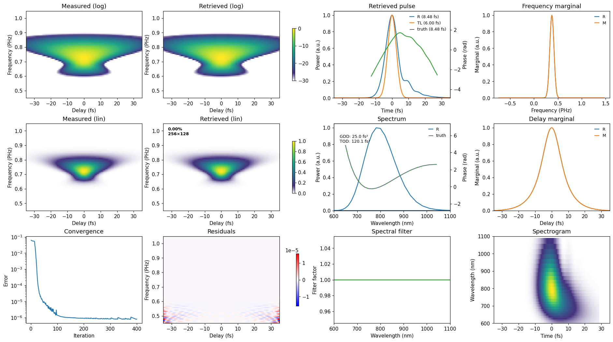

# croak

**Complete Retrieval by Optimisation and Adjoint Kernels**

[](https://github.com/LupoLab/croak/actions/workflows/ci.yml)
[](https://codecov.io/gh/LupoLab/croak)
[](https://croak.readthedocs.io)
[](https://github.com/astral-sh/ruff)
[](https://github.com/microsoft/pyright)
[](https://pypi.org/project/croak/)
[](https://pypi.org/project/croak/)
[](LICENSE)
[](https://doi.org/10.5281/zenodo.22182305)

**Retrieval of ultrashort laser pulses from FROG traces — spectral amplitude
and phase.**

> **Just want the graphical FROG retrieval program?**
> See [Installing the GUI](https://croak.readthedocs.io/en/latest/getting_started/gui.html)
> for install instructions that need no Python knowledge.

croak reconstructs the complex electric field of an ultrashort pulse from a
frequency-resolved optical gating (FROG) trace. It is a retrieval package for
the PNPS (parameterised nonlinear process spectra) class of measurements,
currently focused on FROG: the SHG, SD and PG/transient-grating geometries, ten
solvers over a single physical forward model, and the workflow around them
(loading, cleaning, retrieval, post-processing, dispersion tuning, uncertainty,
plotting and saving). The library is headless (NumPy/SciPy/JAX); a PyQt6 GUI is
optional.

What distinguishes croak from a classic FROG code is the forward model.
Standard retrieval assumes an infinitely thin, non-dispersive nonlinear medium,
an ideal beam geometry and perfect signal collection. Those assumptions fail for
few-femtosecond pulses in the deep ultraviolet. On simulated deep-UV TG-FROG
scans of a complete instrument, the standard thin-medium model fits the trace to
a residual below 0.54 % yet returns 1.35–2.41 fs for a 1.05 fs pulse over 1–40 µm
of fused silica. A small trace error alone does not certify a retrieval. croak
instead models the measurement physics directly:

- **dispersive propagation** of the input fields and the generated signal
  through the nonlinear medium;
- **geometric delay smearing** of the crossed-beam (BOXCARS) geometry, with a
  closed-form kernel set by the mask geometry, or fitted from the data;
- **chromatic focusing and the collection aperture**, as a coherent chromatic
  filter on the signal (the full focal model).

With the full model croak retrieves 1.047–1.079 fs against the 1.053 fs truth at
all fifteen thicknesses from 1 to 40 µm. Because the model is a differentiable
JAX program, retrieval is ordinary regularised least squares: measured spectra,
per-frequency response factors and fitted physical parameters (medium thickness,
delay zero, smearing strength) enter by adding them to the objective. The
methods and the validation are described in two papers in preparation (see
[Citation](#citation)) and summarised in the
[validation chapter](https://croak.readthedocs.io/en/latest/explanation/validation.html);
the [capabilities overview](https://croak.readthedocs.io/en/latest/reference/features.html)
lists everything the package does.



## Install

croak is [on PyPI](https://pypi.org/project/croak/) and needs **Python ≥ 3.14**.
The easiest route on every platform is [uv](https://docs.astral.sh/uv/), which
installs the right Python for you:

```bash
uv add croak                 # into a uv project
```

or into any environment of your own (`uv pip install croak`, or plain
`pip install croak`). For the GUI as a standalone command, without a project:

```bash
uv tool install --python 3.14 "croak[gui]"
croak-gui
```

To work on croak itself — or to run the bundled examples, which ship with the
repository rather than the package — install from a clone:

```bash
git clone https://github.com/LupoLab/croak
cd croak
uv sync                  # create the environment and install croak
uv run python -c "import croak; print(croak.__version__)"
```

Then run anything inside that environment with `uv run`:

```bash
uv run python my_retrieval.py
uv run croak-gui
```

<details>
<summary><b>Platform notes</b>: read this if the install fails</summary>

The binary dependencies (`jax`, `nlopt`, `finufft`, `pyqt6`) do not publish
wheels for every platform. Where a wheel is missing, pip/uv falls back to
building from source, which needs CMake and a C++ toolchain.

| Platform | Status |
|---|---|
| **Linux x86_64** (glibc ≥ 2.34, i.e. Ubuntu 22.04+/RHEL 9+) | supported |
| **macOS, Apple Silicon**, macOS ≥ 14 | supported |
| **Windows x86_64** | supported |
| **macOS, Intel** | not supported: there is no current `jaxlib` wheel |
| **Linux aarch64** | `nlopt` and `finufft` build from source |

**Linux also needs Qt's system libraries** for the GUI (neither uv nor pip
provides these):

```bash
sudo apt-get install -y libegl1 libgl1 libxkbcommon-x11-0 libdbus-1-3 \
  libxcb-icccm4 libxcb-image0 libxcb-keysyms1 libxcb-randr0 \
  libxcb-render-util0 libxcb-shape0 libxcb-xinerama0 libxcb-cursor0
```

**Python 3.14 is a hard floor**, not a preference: the source uses 3.14 syntax
and does not parse on 3.13. `uv python install 3.14` is the simplest fix.

**JAX installs CPU-only by default**, which suits the standard and extended
models. For the full focal model, install `jax[cuda12]` and use a GPU; see
[Performance](#performance).

Prefer plain pip? `python3.14 -m venv .venv && . .venv/bin/activate && pip install -e .`

</details>

The [installation guide](https://croak.readthedocs.io/en/latest/getting_started/installation.html)
covers all of this in more detail.

Optional extras: `croak[gui]` (the wizard) and
`croak[evo]` (the cma-es global solver; pulls in `evosax` and its
`flax`/`optax` dependency tree). In a clone the same extras are
`uv sync --extra gui` etc.

## Quick start

```python
import numpy as np
import croak

# a time/frequency grid and a test pulse (2.5 fs Gaussian with some GDD)
g = croak.Grid(128, dt=0.3e-15)
ew = croak.gaussian_pulse(g, 2.5e-15, phases=[4e-30])   # phases = [GDD, TOD, ...]
delays = np.linspace(-18e-15, 18e-15, 87)

# generate a synthetic SHG-FROG trace
trace = croak.maketrace(g.omega, delays, ew, "shg")

# retrieve — the same call for every algorithm ("warm-lbfgs" is the default)
res = croak.retrieve(trace, g.omega, delays, "shg", algorithm="copra",
                     guess=croak.gaussian_pulse(g, 1.8e-15), maxiters=300,
                     rng=np.random.default_rng(0))
print(res.error)            # final trace error R
field = res.field           # retrieved E(t)
spectrum = res.spectrum     # retrieved E(omega)
```

On measured data the workflow is the same shape, with cleaning in front:

```python
fd = croak.io.list_datasets("frog.h5")          # generic HDF5/NPZ dataset picker
lam = fd.load("wavelength") * croak.io.unit_to_si("nm")
delays = fd.load("delay") * croak.io.unit_to_si("fs")

td = croak.load_and_clean(fd.load("trace"), lam, delays, "shg",
                          lam_min=730e-9, lam_max=900e-9, input_unit="delay")

result = croak.retrieve_from_tracedata(td, algorithm="lbfgs", maxiters=200)
pr = croak.process_result(result, measured=td.trace)
croak.plot_retrieval(result, measured=td.trace).savefig("retrieval.png")
croak.save_result(result, "retrieval.h5", processed=pr)
```



## Solvers

Ten solvers in four algorithm families sit behind one `algorithm=` argument
over a single forward model. The
[solver guide](https://croak.readthedocs.io/en/latest/howto/solver_selection.html)
explains which model options each supports.

| `algorithm` | Gradient | Use it for |
|---|---|---|
| `"warm-lbfgs"` | JAX autodiff | **the default**: `lbfgs-ad` started from a COPRA sweep, much less sensitive to the initial guess |
| `"lbfgs-ad"` | JAX autodiff | the complete model: smearing, fitted thickness/τ₀, B-spline basis, penalties |
| `"copra"` | analytic adjoint | fast and robust from poor guesses (thin or dispersive medium) |
| `"lbfgs"` | analytic adjoint | phase-only, or custom regularisation, in pure NumPy |
| `"lm"` | JAX Jacobian | Levenberg–Marquardt polish to the lowest trace error |
| `"cma-es"` | none (global) | escaping a poor local minimum with no good guess |
| `"copra-jax"`, `"lbfgs-hand"`, `"lbfgs-optx"`, `"lm-optx"` | | on-device variants of the above |

For the core model (all three interactions, thin or dispersive medium) croak
also carries a hand-derived Wirtinger adjoint: exact closed-form gradients that
verify the automatic differentiation. The AD route carries everything else,
including the physics the projection-based algorithms cannot (the smearing
mixture and the collection model), so a new model feature needs no new
derivation. The manual gives the
[adjoint derivations](https://croak.readthedocs.io/en/latest/explanation/gradients.html),
[objective](https://croak.readthedocs.io/en/latest/explanation/retrieval_theory.html)
and [model equations](https://croak.readthedocs.io/en/latest/explanation/forward_model.html).

## Performance

The forward model is JAX throughout, so the same code runs on CPU or GPU. The
standard and extended models retrieve in seconds on a laptop CPU. The full focal
model (the chromatic focal mixture with the modelled collection aperture) is
where the GPU matters. In our timings it ran about **60× faster on an NVIDIA
H200 than on an Intel Xeon Gold 6240** (all cores) and **6.4× faster than on an
Apple M5 Max** with full threading, which is itself about 10× the Xeon. Install
commands for CUDA-enabled JAX (project, checkout and GUI tool installation) are
in the
[installation guide](https://croak.readthedocs.io/en/latest/getting_started/installation.html#jax-and-gpus).

## Scope

croak is built on the PNPS formalism: the same mathematics describes
frequency-resolved optical gating, time-domain ptychography, cross-correlation
FROG and dispersion scan, differing in the signal operator and the scan
parameter. croak ships the three FROG interactions, with delay as the scan
parameter throughout. XFROG, TDP and d-scan are natural extensions, but each
needs its own scan and forward-model support, not only a new interaction; see
[Interactions](https://croak.readthedocs.io/en/latest/explanation/interactions.html).

The instrument simulations behind the validation, and the bundled example
datasets, were produced with [ModelPNPS.jl](https://github.com/LupoLab/ModelPNPS.jl),
a separate Julia package that simulates PNPS measurements in three dimensions
from the underlying propagation physics.

## GUI

A PyQt6 wizard (Load → Marginal check → Preprocess → Retrieve → Dispersion →
Uncertainty) drives the same library functions, with embedded plots, threaded
retrieval and a live preview:

```bash
uv run croak-gui          # or: uv run python -m croak.gui
```

Sessions save to TOML, and `croak replay` reruns one headlessly — or
`croak script` turns it into a standalone Python file you can edit. Importing
`croak` does **not** require Qt; only `croak.gui` does. See
[Installing the GUI](https://croak.readthedocs.io/en/latest/getting_started/gui.html) and the
[GUI guide](https://croak.readthedocs.io/en/latest/howto/gui.html).

## Examples

```bash
uv run python examples/example_retrieval.py              # shapes, geometries, noise, dispersion
uv run python examples/example_workflow.py               # load → retrieve → save
uv run python examples/example_paper_thickness.py        # a simulated 1 fs DUV trace, extended vs standard model
uv run python examples/example_paper_rdw.py              # a simulated single-cycle RDW pulse
uv run python examples/example_geometric_smearing.py     # BOXCARS time smearing
uv run python examples/example_defringe.py               # interferometric fringe removal
uv run python examples/example_arpls_baseline.py         # + asymmetric baseline removal
uv run python examples/example_thickness_uncertainty.py  # fitted thickness & error bars
```

The first examples synthesise their own data. The two `example_paper_*`
scripts retrieve from the bundled reduced simulation datasets in
[`examples/data/`](examples/data/README.md). The examples and their data live in
the repository, not in the PyPI package, so run them from a clone. The
[example gallery](https://croak.readthedocs.io/en/latest/examples/index.html)
explains their inputs and outputs. The examples use a general workflow
(`warm-lbfgs`, de-fringing on), not the protocol of the papers' validation
retrievals, so their durations differ from the published numbers.

## Documentation

Hosted at [croak.readthedocs.io](https://croak.readthedocs.io): tutorials, the
PNPS theory and the dispersive forward model, the solvers and gradient routes,
how-to guides, the validation results and the full API reference. The
[Features](https://croak.readthedocs.io/en/latest/reference/features.html) page lists everything the package does.
To build locally:

```bash
uv sync --group docs
uv run sphinx-build -b html docs docs/_build/html
```

Start with the [Introduction](https://croak.readthedocs.io/en/latest/introduction/index.html),
then follow the [User guide](https://croak.readthedocs.io/en/latest/user_guide/index.html)
or explore the [Examples](https://croak.readthedocs.io/en/latest/examples/index.html).
The [Developer's guide](https://croak.readthedocs.io/en/latest/developer_guide/index.html)
covers contributing, and the [API](https://croak.readthedocs.io/en/latest/reference/api/index.html)
documents the Python interfaces.

## The name

croak stands for *Complete Retrieval by Optimisation and Adjoint Kernels*. It
was called `toad` (*Trace Optimisation through Automatic Differentiation*)
while it was an internal tool, and was renamed for release because that name
was already taken on PyPI — hence the unchanged amphibian on the icon. See
[the docs](https://croak.readthedocs.io/en/latest/reference/naming.html).

## Citation

If you use croak in published work, please cite the paper describing it:

> J. C. Travers and C. Brahms, "Differentiable physical models for
> ultrashort-pulse retrieval", in preparation.

The dispersive and spatial TG-FROG model is described in

> J. C. Travers and C. Brahms, "A dispersive and spatial model of
> transient-grating frequency-resolved optical gating", in preparation.

Publication details will be added when available. Cite the software itself via
[doi:10.5281/zenodo.22182305](https://doi.org/10.5281/zenodo.22182305) (all
versions) or [CITATION.cff](CITATION.cff). The
[references](https://croak.readthedocs.io/en/latest/reference/bibliography.html)
list the published work croak's methods build on.

## Authors and licence

croak is developed by John Travers and Christian Brahms in the
[LUPO research group](https://lupo-lab.com) at Heriot-Watt University.
Released under the MIT licence — see [LICENSE](LICENSE).
